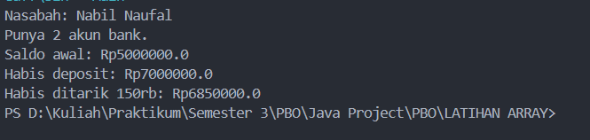

# TUGAS-1-ARRAYYY
# Simple Banking System

Simple Banking System merupakan aplikasi sederhana yang dibuat menggunakan Java untuk menggambarkan proses pengelolaan nasabah dan rekening bank. Program ini menggunakan konsep *Object-Oriented Programming* (OOP) dengan membagi program menjadi beberapa kelas, yaitu `Main`, `Bank`, `Customer`, dan `Account`.

Melalui program ini, pengguna dapat melihat bagaimana data nasabah dikelola, rekening dibuat, saldo diperiksa, uang disetorkan (*deposit*), serta uang ditarik (*withdraw*).

## Fitur Utama

- **Pengelolaan Nasabah:** Menyimpan data nasabah berdasarkan nama depan dan nama belakang.
- **Pengelolaan Rekening:** Menghubungkan rekening dengan nasabah yang memilikinya.
- **Pengecekan Saldo:** Melihat jumlah saldo yang tersimpan dalam rekening.
- **Deposit:** Menambah saldo rekening menggunakan nominal positif.
- **Withdraw:** Mengurangi saldo rekening dengan nominal positif selama jumlah penarikan tidak melebihi saldo yang tersedia.
- **Validasi Transaksi:** Memastikan nominal setoran valid dan mencegah penarikan yang melebihi saldo rekening.

## Struktur File

```text
Simple-Banking-System/
├── Main.java
├── Bank.java
├── Customer.java
├── Account.java
└── README.md
```

### Penjelasan Kelas

**1. `Main.java`**

- Berfungsi sebagai bagian utama untuk menjalankan program.
- Membuat objek bank dan memasukkan data nasabah.
- Membuat dua rekening dengan saldo awal yang berbeda.
- Menampilkan nama nasabah, jumlah rekening yang dimiliki, dan informasi saldo.
- Menjalankan contoh transaksi berupa deposit dan withdraw.

**2. `Bank.java`**

- Menyimpan kumpulan data nasabah dalam sebuah array.
- Memiliki method `addCustomer()` untuk memasukkan nasabah baru.
- Menyediakan method `getNumOfCustomers()` untuk mendapatkan jumlah nasabah.
- Menggunakan method `getCustomer()` untuk memperoleh data nasabah berdasarkan indeksnya.
- Menampung maksimal 10 nasabah.

**3. `Customer.java`**

- Menyimpan informasi nama depan dan nama belakang nasabah.
- Mengatur kumpulan rekening yang dimiliki oleh nasabah.
- Menyediakan method untuk mengakses informasi nama dan rekening nasabah.
- Membatasi jumlah rekening hingga maksimal 5 rekening untuk setiap nasabah.

**4. `Account.java`**

- Bertanggung jawab untuk menyimpan dan mengatur saldo rekening.
- Menyediakan method `getBalance()` untuk melihat saldo rekening.
- Menggunakan method `deposit()` untuk menambahkan saldo.
- Menggunakan method `withdraw()` untuk mengurangi saldo melalui transaksi penarikan.

## Teknologi yang Digunakan

- **Bahasa Pemrograman:** Java
- **Paradigma Pemrograman:** *Object-Oriented Programming* (OOP)
- **Struktur Data:** Array

  

